<div align="center">


<a href="https://github.com/DenverCoder1/readme-typing-svg">
  
</a>

<br/>

[](https://linkedin.com/in/tamimshadman)
[](https://github.com/tamim-shadman)
[](https://github.com/tamim-shadman)

</div>

---

## 💫 About Me

> *Bridging cutting-edge ML research and seamless user experiences — turning powerful tech into high-performance digital products that make a real-world impact.*

I'm an innovative **Software Engineer** and **AI Specialist** passionate about the full stack of AI development — from training Computer Vision and NLP models to building the responsive, intuitive interfaces users actually interact with. Whether I'm designing multi-tier LLM fallback architectures, engineering complex datasets, or integrating robust AI into end-to-end applications, I'm driven by the challenge of making powerful tech feel effortless.

```python
tamim = {
    "location"   : "Dhaka, Bangladesh 🇧🇩",
    "education"  : "Recently Graduated · Computer Science",
    "focus"      : ["AI/ML Engineering", "LLM Systems", "Full-Stack Dev"],
    "working_on" : ["NewsFlow AI — 4-tier LLM news aggregator",
                    "HybridSum — Adaptive Temporal Abstraction (research)"],
    "learning"   : ["Explainable AI (LIME & SHAP)", "Advanced React & TypeScript"],
    "ask_me"     : ["PyTorch", "Transformers", "Neural Nets", "Large-Scale Datasets"],
    "available"  : True  # Open to remote opportunities worldwide 🌍
}
```

---

## 🚀 Active Projects

<table>
<tr>
<td width="50%" valign="top">

**📰 NewsFlow AI**

A smart news aggregator powered by a **4-tier LLM fallback architecture**, delivering intelligent, context-aware news summarization at scale.


</td>
<td width="50%" valign="top">

**📄 HybridSum Research**

Research paper on **Adaptive Temporal Abstraction Learning** — a novel approach combining extractive & abstractive summarization with temporal reasoning.


</td>
</tr>
</table>

---

## 🧠 Core Expertise

<table>
<tr>
  <td align="center" valign="top" width="25%">
    <br/>
    
    <br/><br/>
    <sub>PyTorch · Transformers · CNNs · Deep Learning · Computer Vision · NLP · LIME & SHAP</sub>
    <br/><br/>
  </td>
  <td align="center" valign="top" width="25%">
    <br/>
    
    <br/><br/>
    <sub>Multi-tier Fallback Arch · End-to-End AI Pipelines · Production Deployment</sub>
    <br/><br/>
  </td>
  <td align="center" valign="top" width="25%">
    <br/>
    
    <br/><br/>
    <sub>React · TypeScript · Flutter · Node.js · FastAPI · Django · TailwindCSS</sub>
    <br/><br/>
  </td>
  <td align="center" valign="top" width="25%">
    <br/>
    
    <br/><br/>
    <sub>Large-Scale Dataset Processing · Feature Engineering · ML Pipelines</sub>
    <br/><br/>
  </td>
</tr>
</table>

---

## 💻 Tech Stack

### 🤖 AI & Machine Learning


### 🌐 Languages


### 🛠️ Frameworks & Libraries


### 🗄️ Databases & Cloud


### ⚙️ DevOps & Tools


![Canva](https://img.shields.io/badge/Canva-%2300C4CC.svg?style=for-the-badge&logo=data%3Aimage%2Fsvg%2Bxml%3Bbase64%2CPHN2ZyByb2xlPSJpbWciIHZpZXdCb3g9IjAgMCAyNCAyNCIgeG1sbnM9Imh0dHA6Ly93d3cudzMub3JnLzIwMDAvc3ZnIj48dGl0bGU%2BQ2FudmE8L3RpdGxlPjxwYXRoIGZpbGw9IiNmZmZmZmYiIGQ9Ik0xMiAwQzUuMzczIDAgMCA1LjM3MyAwIDEyczUuMzczIDEyIDEyIDEyIDEyLTUuMzczIDEyLTEyUzE4LjYyNyAwIDEyIDB6TTYuOTYyIDcuNjhjLjc1NCAwIDEuMzM3LjU0OSAxLjQwNSAxLjIuMDY5LjU4My0uMTcxIDEuMDk3LS44MjIgMS40MDYtLjM0My4xNzEtLjQ4LjE3Mi0uNTQ5LjA2OS0uMDM0LS4wNjkgMC0uMTM3LjA2OS0uMjA2LjYxNy0uNTE0LjYxNy0uOTI2LjU0OC0xLjUwOC0uMDM0LS4zNzgtLjMwOC0uNjE4LS41ODMtLjYxOC0xLjIgMC0yLjkxNCAyLjY3NC0yLjY3NCA0LjYyOS4xMDMuNzU0LjU0OSAxLjY0NiAxLjUwOSAxLjY0Ni4zMDggMCAuNjUtLjEwMy45Ni0uMjQuNS0uMjY0Ljc5OS0uNDcgMS4wOTctLjgtLjA3My0uODg1LjcwNC0yLjA0NiAxLjg1MS0yLjA0Ni41MTUgMCAuOTI2LjIwNS45Ni41ODMuMDY4LjUxNC0uMzc3LjU4Mi0uNTE0LjU4MnMtLjM3OC0uMDM0LS4zNzgtLjE3Yy0uMDM0LS4xMzguMzA5LS4wNy4yNzUtLjM3OC0uMDM1LS4yMDYtLjI0LS4yNzQtLjQ0Ni0uMjc0LS43MiAwLTEuMTMxLjk5NC0xLjAyOSAxLjYxMS4wMzUuMjc1LjE3Mi41NDkuNDQ3LjU0OS4yMDUgMCAuNTE0LS4zMS42MTctLjc1NS4wNjgtLjMwOC4zNDMtLjUxNC41ODMtLjUxNC4xMDIgMCAuMTcuMDM0LjIwNS4xNzF2LjEzOGMtLjAzNC4xMzctLjEzNy41NDgtLjEwMi42NTEgMCAuMDY5LjAzNC4xNzEuMTcuMTcxLjA5MiAwIC40MzYtLjE4Ljc3Ny0uNDU5LjExNy0uNTkuMjUzLTEuMjk4LjI1My0xLjM1Ny4wMzQtLjI0LjEzNy0uNDguNjE3LS40OC4xMDMgMCAuMTcxLjAzNC4yMDUuMTcxdi4xMzhsLS4xMzYuNjE3Yy40NDUtLjU4MyAxLjA5Ny0uOTk0IDEuNTA4LS45OTQuMTcyIDAgLjMwOS4xMDIuMzA5LjI3NCAwIC4xMDMgMCAuMjc0LS4wNjkuNDQ2LS4xMzcuMzc3LS4zMDkuOTYtLjQxMiAxLjQ3NCAwIC4xMzcuMDM1LjI3NC4yMDcuMjc0LjE3MSAwIC42ODUtLjIwNiAxLjA5Ni0uNzU0bC4wMDctLjAwNGMtLjAwMi0uMDY4LS4wMDctLjEzNC0uMDA3LS4yMDIgMC0uNDExLjAzNS0uNzU0LjEwNC0uOTk0LjA2OC0uMjc0LjQxMS0uNTE0LjYxNy0uNTE0LjEwMyAwIC4yMDUuMDY5LjIwNS4xNzEgMCAuMDM1IDAgLjEwMy0uMDM0LjEzNy0uMTM3LjQ0Ni0uMjQuODU3LS4yNCAxLjI2OSAwIC4yNC4wMzQuNTgyLjEwMi43ODggMCAuMDM0LjAzNS4wNjkuMDcuMDY5LjA2OCAwIC41NDgtLjQ0NS44OS0xLjAyOC0uMzA4LS4yMDYtLjQ4LS41NDktLjQ4LS45NiAwLS43Mi40NDYtMS4wOTcuODU4LTEuMDk3LjM0MyAwIC42MTcuMjQuNjE3LjcyIDAgLjMwOC0uMTAzLjY1LS4yNzQuOTZoLjEwMmEuNzcuNzcgMCAwIDAgLjU4NC0uMjQuMjkzLjI5MyAwIDAgMSAuMTM0LS4xMTdjLjMzNS0uNDI1LjgzLS43NCAxLjQxLS43NC40OCAwIC45MjQuMjA1Ljk1OS41ODIuMDY4LjUxNS0uMzc4LjYxOC0uNTE1LjYxOGwtLjAwMi0uMDAyYy0uMTM4IDAtLjM3Ny0uMDM1LS4zNzctLjE3MiAwLS4xMzcuMzA5LS4wNjguMjc0LS4zNzYtLjAzNC0uMjA2LS4yNC0uMjc1LS40NDYtLjI3NS0uNjg2IDAtMS4xMy44OTEtMS4wMjggMS42MTEuMDM0LjI3NS4xNzEuNTgzLjQ0NS41ODMuMjA2IDAgLjUxNS0uMzA4LjY1Mi0uNzU0LjA2OC0uMjc0LjM0My0uNTE0LjU4My0uNTE0LjEwMyAwIC4xNy4wMzQuMjA1LjE3MSAwIC4wNjkgMCAuMjA2LS4xMzcuNjUyLS4xNy4zMDgtLjE3MS40OC0uMTM3LjYxNy4wMzQuMjc0LjE3MS40OC4zMDkuNTgzLjAzNC4wMzQuMDY4LjEwMi4wNjguMTAyIDAgLjA2OS0uMDM0LjEzOC0uMTM3LjEzOC0uMDM0IDAtLjA2OCAwLS4xMDMtLjAzNS0uNTE0LS4yMDUtLjcyLS41NDgtLjc4OS0uODkxLS4yMDUuMjQtLjQ0NS4zNzctLjcyLjM3Ny0uNDQ1IDAtLjg5LS40MTEtLjk2LS45MjZhMS42MDkgMS42MDkgMCAwIDEgLjA3NS0uNjQ5Yy0uMjAzLjEzLS40MjIuMjAzLS42MjMuMjAzaC0uMTdjLS40NDcuNjUyLS45MjcgMS4wOTgtMS4yNyAxLjMwM2EuODk2Ljg5NiAwIDAgMS0uMzc3LjEwNGMtLjA2OCAwLS4xNzEtLjAzNS0uMjA1LS4xMDQtLjA5NS0uMTUyLS4xNTYtLjM5Mi0uMTkzLS42NjctLjQ4MS41MjctMS4xNDUuODA1LTEuNDUzLjgwNS0uMzQzIDAtLjU0OC0uMjA2LS41ODItLjU1di0uMzc2Yy4xMDItLjc1NC4zNzctMS4yLjM3Ny0xLjMzN2EuMDc0LjA3NCAwIDAgMC0uMDY5LS4wN2MtLjI0IDAtMS4wMjguODI0LTEuMTY2IDEuMzczbC0uMTAzLjQ0NWMtLjA2OC4zMDktLjM3Ny41MTUtLjU4Mi41MTUtLjEwMyAwLS4xNzItLjAzNS0uMjA2LS4xNzJ2LS4xMzdsLjA0Ni0uMjMzYy0uNDM1LjMxLS44Ny41MDgtMS4wNzUuNTA4LS4zMDggMC0uNDgtLjE3Mi0uNTE0LS40MTItLjIwNi4yNzQtLjQ0NS40MTItLjc1NC40MTItLjM1MiAwLS42OTYtLjI0LS44NjItLjU5My0uMjQ0LjI3NS0uNTIzLjU1My0uODUyLjc2NC0uNDguMzA5LTEuMDI4LjU0OS0xLjY4LjU0OS0uNTgyIDAtMS4wOTctLjMwOS0xLjM3MS0uNTgzLS40MTItLjM3Ny0uNjUxLS45Ni0uNjg2LTEuNTA5LS4yMDUtMS42OC44MjMtMy44NCAyLjQtNC44LjM3OC0uMjA1Ljc1NS0uMzQzIDEuMTMyLS4zNDN6bTkuNzcgMy4yOTFjLS4xMDQgMC0uMTcyLjE3Mi0uMTcyLjM0MyAwIC4yNzQuMTM3LjU4My4zMDkuNzU1YTEuNzQgMS43NCAwIDAgMCAuMTAyLS41ODNjMC0uMzQzLS4xMzctLjUxNS0uMjQtLjUxNXoiLz48L3N2Zz4%3D)


---

## 📊 GitHub Stats

<p align="center">
  
  
</p>

<p align="center">
  
</p>

---

## 🤝 Let's Collaborate

<table>
<tr>
<td width="50%">

**👯 Looking to collaborate on**

Open-source AI/ML projects involving Computer Vision, NLP, or integrating Deep Learning models into full-stack web apps.

</td>
<td width="50%">

**🤝 Looking for help with**

Scaling large language models for production and advanced cloud deployment strategies.

</td>
</tr>
<tr>
<td width="50%">

**🌱 Currently learning**

Deeper aspects of Explainable AI (LIME & SHAP) and advanced state management in React & TypeScript.

</td>
<td width="50%">

**💬 Ask me about**

PyTorch, Transformers, building neural networks, and processing large-scale datasets efficiently.

</td>
</tr>
</table>

---

## ✍️ Random Dev Quote

<p align="center">
  
</p>

---

<div align="center">


*Built with ❤️ by Tamim · Open to remote opportunities worldwide*

</div>
